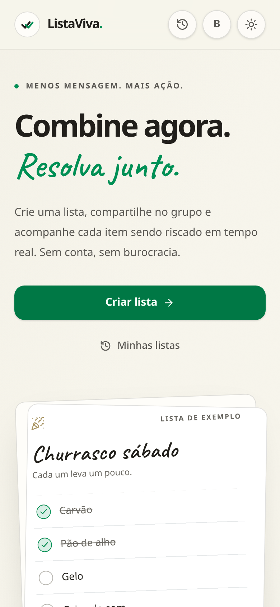
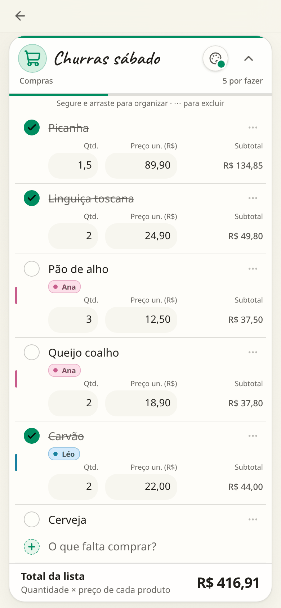
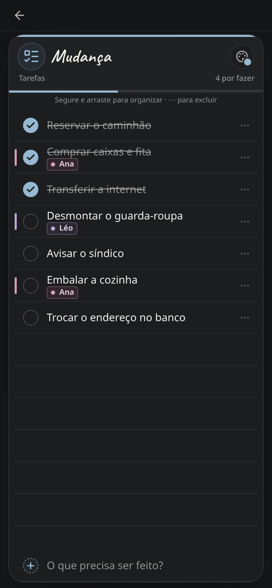
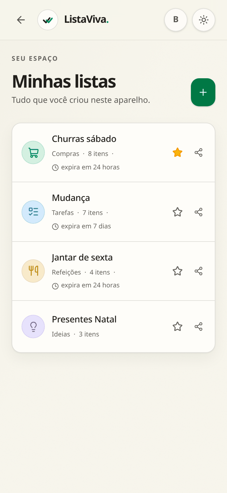
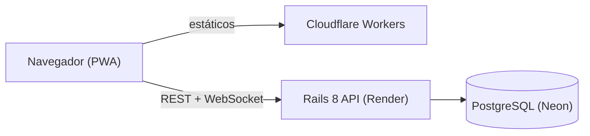

<div align="center">


# ListaViva

**Listas colaborativas em tempo real. Sem cadastro, compartilhadas por link.**

[](https://github.com/br1ansouza/listaviva/actions/workflows/ci.yml)
[](https://github.com/br1ansouza/listaviva/releases)

[**Abrir o app →**](https://listaviva.br1ansouza.workers.dev)

<br>






</div>

<br>

Você cria uma lista, manda o link no grupo do WhatsApp e todo mundo edita junto. Alguém risca o carvão no mercado e o risco aparece na hora no celular de quem ficou em casa. Ninguém precisa criar conta nem instalar nada.

## O que tem

- **Cinco tipos de lista:** tarefas, compras, evento, refeições e ideias, cada uma com cor e ícone.
- **Edição ao vivo:** adicionar, renomear, riscar e reordenar itens arrastando. Cada item mostra quem escreveu.
- **Conta do mercado:** quantidade (inclusive fracionada) e preço por item, com subtotal e total da lista.
- **Link com validade:** 8 horas, 1 dia ou 1 semana. Quando vence, a lista continua no histórico de quem criou e pode ganhar outro link.
- **PWA:** instalável, com tema claro e escuro.

## Como funciona



**Tempo real sem Redis.** As escritas chegam por HTTP, são gravadas e transmitidas pelo Action Cable no canal da lista. O pub/sub é o Solid Cable, que usa o próprio PostgreSQL, e os jobs rodam no Solid Queue, também no banco. A infraestrutura inteira é um processo Rails e um Postgres.

**Interface otimista.** O cliente aplica a mudança antes de o servidor responder e depois reconcilia com a confirmação e com os eventos dos outros participantes, em qualquer ordem de chegada. Não há CRDT: os itens são pequenos o bastante para "a última escrita vence" funcionar bem.

**Identidade sem cadastro.** O navegador gera um UUID, guardado em `localStorage` e em cookie, e o envia em cada requisição. Esse UUID é a credencial de quem criou a lista e nunca sai do servidor de volta: os IDs de autoria que aparecem nas respostas são derivados por HMAC e mudam de uma lista para outra. O link compartilhado é uma segunda credencial, que dá direito de edição enquanto for válido.

**Hospedagem gratuita, com as limitações dela.** A API dorme depois de alguns minutos sem tráfego e leva cerca de um minuto para acordar; o app avisa e reconecta sozinho. Se ela não voltar, o Worker que serve o frontend confirma a queda e dispara um novo deploy. Cotas de listas, itens, requisições e conexões seguram o uso dentro do plano gratuito. Os detalhes estão em [SECURITY.md](SECURITY.md).

## Stack

| | |
| --- | --- |
| Frontend | React 19, TypeScript, Rsbuild, Tailwind CSS 4, shadcn/ui, Motion, Zustand |
| Backend | Ruby on Rails 8.1 (API), Action Cable, Solid Cable, Solid Queue |
| Banco | PostgreSQL 16 |
| Qualidade | Minitest, `bun test`, Biome, `tsc`, RuboCop, Brakeman, Bundler Audit |
| Hospedagem | Cloudflare Workers, Render, Neon |

## Rodando localmente

Requisitos: Git, [Bun](https://bun.sh) e Docker com Compose. Ruby e PostgreSQL rodam em containers.

```bash
git clone --branch dev https://github.com/br1ansouza/listaviva.git
cd listaviva
cp .env.example .env                 # preencha POSTGRES_USER, POSTGRES_PASSWORD e POSTGRES_DB

(cd frontend && bun install --frozen-lockfile)

docker compose up -d --wait db
docker compose run --build --rm api bin/rails db:prepare

./scripts/dev.sh
```

O frontend sobe em [localhost:5173](http://localhost:5173) e a API em [localhost:3000](http://localhost:3000). `Ctrl+C` encerra o frontend; `docker compose stop` para a API e o banco.

O `scripts/dev.sh` também ativa os hooks de Git do projeto: o `pre-commit` roda Biome, `tsc` e RuboCop nos arquivos alterados, e o `pre-push` gera o build.

<details>
<summary>Comandos úteis</summary>

```bash
# em frontend/
bun run check       # Biome e TypeScript
bun test            # testes de unidade
bun run verify      # check + build de produção

# na raiz
docker compose logs -f api
docker compose run --rm api bin/rails console
docker compose run --rm api bin/rubocop
docker compose run --rm -e RAILS_ENV=test api bin/rails test
```

</details>

## Contribuindo

O fluxo é `feature/*` → `dev` → `main`. Abra o PR da sua branch para a `dev`; a `main` é a versão publicada e só recebe PRs vindos da `dev`.

Os commits seguem Conventional Commits em português e minúsculas (`feat:`, `fix:`, `docs:`, `chore:`). O código não leva comentários: o motivo de cada decisão fica no commit ou na descrição do PR.

## Deploy

Cada push na `main` passa pela [CI](.github/workflows/ci.yml) e, com tudo verde, publica a API no Render e o frontend no Cloudflare Workers. Tags `v*` geram um [release](https://github.com/br1ansouza/listaviva/releases) com o bundle do frontend e a imagem da API em `ghcr.io/br1ansouza/listaviva/api`.

---

Feito por [Brian Souza](https://github.com/br1ansouza). Código sob a [licença MIT](LICENSE).
